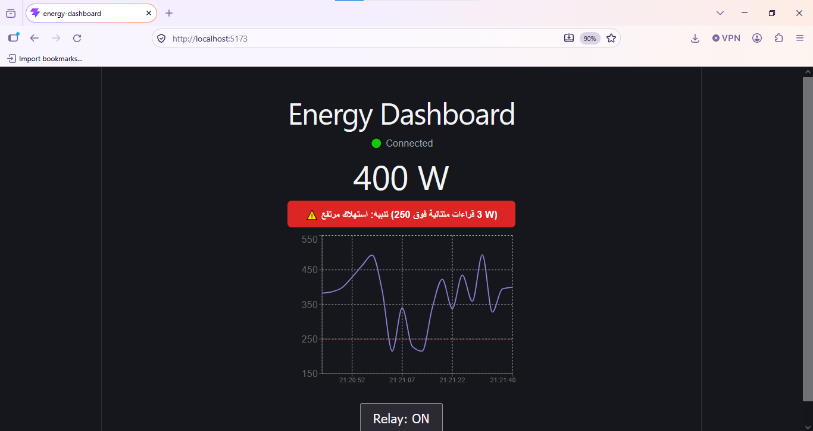

# IoT Energy Dashboard

Real-time energy monitoring dashboard with bidirectional control.
Built as a proof of concept: **Node-RED → MQTT → React**.

## Architecture

```
Node-RED (simulated sensor)  →  MQTT broker  →  React dashboard
        ↑                                              |
        └────────── ON/OFF commands (MQTT) ←───────────┘
```

## Features
- Live power readings over MQTT (WebSocket)
- Real-time chart of the last 20 readings (Recharts)
- Bidirectional control: relay ON/OFF from the UI
- Relay state synchronized via retained MQTT messages
- Smart alert: warning after 3 consecutive readings above threshold

## Tech Stack
React, TypeScript, Vite, mqtt.js, Recharts, Node-RED, MQTT (HiveMQ public broker)

## Run locally
1. Start Node-RED and import `node-red/flow.json`
2. Change the topic prefix (`tt-demo-mohamed`) to your own
3. `npm install && npm run dev`

## Screenshots


## Next steps
Historical storage, realistic data patterns, private broker with authentication, ESP32 integration.